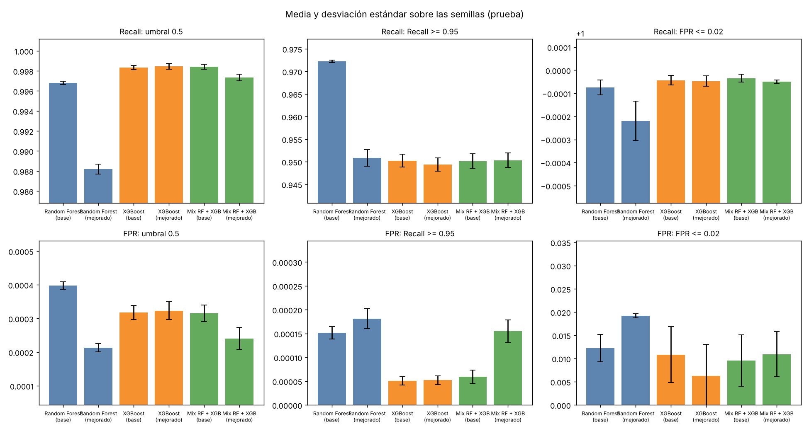
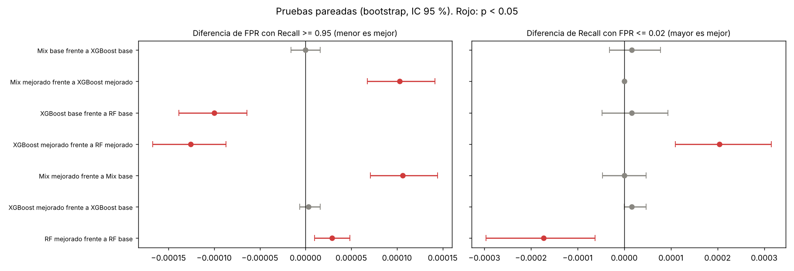

# Experimentos formales: CICIDS2017

Generado por `python -m src.experiments_report`. Todas las cifras son del conjunto de prueba salvo que se indique otra cosa.

## 1. Repetición con varias semillas

Se repitió la partición 70/15/15 y el ajuste de los seis modelos con las semillas [42, 1, 2, 3, 4]. Cada celda es media ± desviación estándar muestral sobre las semillas, en el conjunto de prueba. Los hiperparámetros de las versiones mejoradas son los de la búsqueda con la semilla 42 y no se volvieron a buscar; además, esos datos de ajuste se solapan con las pruebas de las otras semillas. Por eso la desviación subestima la variación real de repetir también la búsqueda.

### Umbral 0.5

| Modelo | Recall | FPR | Precisión | Accuracy | ROC-AUC |
|---|---|---|---|---|---|
| Random Forest (base) | 0.9968 ± 0.0002 | 0.00040 ± 0.00001 | 0.9981 ± 0.0001 | 0.9991 ± 0.0000 | 0.9999 ± 0.0000 |
| Random Forest (mejorado) | 0.9882 ± 0.0005 | 0.00021 ± 0.00001 | 0.9990 ± 0.0001 | 0.9978 ± 0.0001 | 0.9999 ± 0.0000 |
| XGBoost (base) | 0.9983 ± 0.0002 | 0.00032 ± 0.00002 | 0.9985 ± 0.0001 | 0.9995 ± 0.0000 | 1.0000 ± 0.0000 |
| XGBoost (mejorado) | 0.9985 ± 0.0003 | 0.00032 ± 0.00003 | 0.9984 ± 0.0001 | 0.9995 ± 0.0000 | 1.0000 ± 0.0000 |
| Mix RF + XGB (base) | 0.9984 ± 0.0003 | 0.00032 ± 0.00002 | 0.9985 ± 0.0001 | 0.9995 ± 0.0000 | 1.0000 ± 0.0000 |
| Mix RF + XGB (mejorado) | 0.9973 ± 0.0003 | 0.00024 ± 0.00003 | 0.9988 ± 0.0002 | 0.9993 ± 0.0000 | 1.0000 ± 0.0000 |

### Mínimo FPR con Recall >= 0.95

| Modelo | Recall | FPR | Precisión | Accuracy | ROC-AUC |
|---|---|---|---|---|---|
| Random Forest (base) | 0.9722 ± 0.0003 | 0.00015 ± 0.00001 | 0.9992 ± 0.0001 | 0.9951 ± 0.0001 | 0.9999 ± 0.0000 |
| Random Forest (mejorado) | 0.9508 ± 0.0018 | 0.00018 ± 0.00002 | 0.9991 ± 0.0001 | 0.9915 ± 0.0003 | 0.9999 ± 0.0000 |
| XGBoost (base) | 0.9502 ± 0.0014 | 0.00005 ± 0.00001 | 0.9997 ± 0.0000 | 0.9915 ± 0.0002 | 1.0000 ± 0.0000 |
| XGBoost (mejorado) | 0.9494 ± 0.0014 | 0.00005 ± 0.00001 | 0.9997 ± 0.0000 | 0.9913 ± 0.0002 | 1.0000 ± 0.0000 |
| Mix RF + XGB (base) | 0.9502 ± 0.0016 | 0.00006 ± 0.00001 | 0.9997 ± 0.0001 | 0.9915 ± 0.0003 | 1.0000 ± 0.0000 |
| Mix RF + XGB (mejorado) | 0.9504 ± 0.0016 | 0.00016 ± 0.00002 | 0.9992 ± 0.0001 | 0.9914 ± 0.0003 | 1.0000 ± 0.0000 |

### Máximo Recall con FPR <= 0.02

| Modelo | Recall | FPR | Precisión | Accuracy | ROC-AUC |
|---|---|---|---|---|---|
| Random Forest (base) | 0.9999 ± 0.0000 | 0.01224 ± 0.00292 | 0.9438 ± 0.0129 | 0.9898 ± 0.0024 | 0.9999 ± 0.0000 |
| Random Forest (mejorado) | 0.9998 ± 0.0001 | 0.01920 ± 0.00044 | 0.9144 ± 0.0018 | 0.9840 ± 0.0004 | 0.9999 ± 0.0000 |
| XGBoost (base) | 1.0000 ± 0.0000 | 0.01085 ± 0.00602 | 0.9504 ± 0.0265 | 0.9910 ± 0.0050 | 1.0000 ± 0.0000 |
| XGBoost (mejorado) | 1.0000 ± 0.0000 | 0.00628 ± 0.00678 | 0.9711 ± 0.0302 | 0.9948 ± 0.0056 | 1.0000 ± 0.0000 |
| Mix RF + XGB (base) | 1.0000 ± 0.0000 | 0.00956 ± 0.00551 | 0.9560 ± 0.0243 | 0.9921 ± 0.0046 | 1.0000 ± 0.0000 |
| Mix RF + XGB (mejorado) | 0.9999 ± 0.0000 | 0.01094 ± 0.00486 | 0.9497 ± 0.0212 | 0.9909 ± 0.0040 | 1.0000 ± 0.0000 |

### Qué modelo gana en cada semilla

| Semilla | Regla de AGENT.md (mínimo FPR con Recall >= 0.95) | Presupuesto (máximo Recall con FPR <= 0.02) |
|---|---|---|
| 1 | XGBoost (base) | XGBoost (mejorado) |
| 2 | XGBoost (base) | Mix RF + XGB (base) |
| 3 | XGBoost (base) | Mix RF + XGB (base) |
| 4 | XGBoost (base) | XGBoost (base) |
| 42 | XGBoost (mejorado) | XGBoost (mejorado) |

Victorias con la regla de AGENT.md: XGBoost (base) 4, XGBoost (mejorado) 1. Victorias con el presupuesto de FPR: XGBoost (mejorado) 2, Mix RF + XGB (base) 2, XGBoost (base) 1.

### Versión mejorada menos versión base, semilla por semilla

Diferencia media ± desviación estándar de las diferencias emparejadas por semilla. La última columna cuenta las semillas en que la mejorada gana en la métrica que define el punto (menor FPR con Recall >= 0.95, mayor Recall con FPR <= 0.02, y ambas a la vez con umbral 0.5).

| Algoritmo | Punto de operación | Diferencia de Recall | Diferencia de FPR | Semillas en que gana |
|---|---|---|---|---|
| Random Forest | umbral 0.5 | -0.0086 ± 0.0004 | -0.00018 ± 0.00002 | 0 de 5 |
| Random Forest | Recall >= 0.95 | -0.0214 ± 0.0019 | +0.00003 ± 0.00001 | 0 de 5 |
| Random Forest | FPR <= 0.02 | -0.0001 ± 0.0001 | +0.00696 ± 0.00301 | 0 de 5 |
| XGBoost | umbral 0.5 | +0.0001 ± 0.0001 | +0.00001 ± 0.00001 | 2 de 5 |
| XGBoost | Recall >= 0.95 | -0.0008 ± 0.0004 | +0.00000 ± 0.00001 | 2 de 5 |
| XGBoost | FPR <= 0.02 | -0.0000 ± 0.0000 | -0.00457 ± 0.00440 | 3 de 5 |
| Mix RF + XGB | umbral 0.5 | -0.0011 ± 0.0002 | -0.00007 ± 0.00003 | 0 de 5 |
| Mix RF + XGB | Recall >= 0.95 | +0.0002 ± 0.0019 | +0.00010 ± 0.00002 | 0 de 5 |
| Mix RF + XGB | FPR <= 0.02 | -0.0000 ± 0.0000 | +0.00138 ± 0.00577 | 0 de 5 |

## 2. Pruebas pareadas entre modelos

Bootstrap pareado sobre las mismas filas de prueba (semilla 42), cada modelo con su propio umbral elegido en validación. Diferencia = A menos B, con IC 95 % y p bilateral. Mide solo el ruido de muestreo de la prueba. A diferencia de comparar intervalos separados (que pueden solaparse aunque haya diferencia), la prueba pareada aprovecha que ambos modelos ven los mismos flujos.

| Comparación | Punto de operación | Diferencia de Recall [IC 95 %] (p) | Diferencia de FPR [IC 95 %] (p) |
|---|---|---|---|
| RF mejorado frente a RF base | umbral 0.5 | -0.0086 [-0.0094, -0.0078] (p=0.000) | -0.00021 [-0.00026, -0.00015] (p=0.000) |
| RF mejorado frente a RF base | Recall >= 0.95 | -0.0188 [-0.0204, -0.0174] (p=0.000) | +0.00003 [+0.00001, +0.00005] (p=0.002) |
| RF mejorado frente a RF base | FPR <= 0.02 | -0.0002 [-0.0003, -0.0001] (p=0.001) | +0.00647 [+0.00594, +0.00697] (p=0.000) |
| XGBoost mejorado frente a XGBoost base | umbral 0.5 | +0.0002 [+0.0001, +0.0003] (p=0.003) | +0.00001 [-0.00003, +0.00005] (p=0.772) |
| XGBoost mejorado frente a XGBoost base | Recall >= 0.95 | -0.0011 [-0.0021, -0.0002] (p=0.016) | +0.00000 [-0.00001, +0.00002] (p=0.796) |
| XGBoost mejorado frente a XGBoost base | FPR <= 0.02 | +0.0000 [+0.0000, +0.0000] (p=0.766) | -0.00013 [-0.00027, +0.00002] (p=0.086) |
| Mix mejorado frente a Mix base | umbral 0.5 | -0.0013 [-0.0016, -0.0010] (p=0.000) | -0.00012 [-0.00016, -0.00007] (p=0.000) |
| Mix mejorado frente a Mix base | Recall >= 0.95 | +0.0009 [-0.0008, +0.0029] (p=0.303) | +0.00011 [+0.00007, +0.00014] (p=0.000) |
| Mix mejorado frente a Mix base | FPR <= 0.02 | +0.0000 [-0.0000, +0.0000] (p=1.000) | +0.00120 [+0.00092, +0.00148] (p=0.000) |
| XGBoost mejorado frente a RF mejorado | umbral 0.5 | +0.0101 [+0.0093, +0.0109] (p=0.000) | +0.00013 [+0.00008, +0.00017] (p=0.000) |
| XGBoost mejorado frente a RF mejorado | Recall >= 0.95 | -0.0026 [-0.0047, -0.0005] (p=0.015) | -0.00013 [-0.00017, -0.00009] (p=0.000) |
| XGBoost mejorado frente a RF mejorado | FPR <= 0.02 | +0.0002 [+0.0001, +0.0003] (p=0.000) | -0.01660 [-0.01710, -0.01615] (p=0.000) |
| XGBoost base frente a RF base | umbral 0.5 | +0.0013 [+0.0010, +0.0018] (p=0.000) | -0.00009 [-0.00015, -0.00003] (p=0.004) |
| XGBoost base frente a RF base | Recall >= 0.95 | -0.0203 [-0.0219, -0.0187] (p=0.000) | -0.00010 [-0.00014, -0.00006] (p=0.000) |
| XGBoost base frente a RF base | FPR <= 0.02 | +0.0000 [-0.0000, +0.0001] (p=0.837) | -0.01001 [-0.01040, -0.00963] (p=0.000) |
| Mix mejorado frente a XGBoost mejorado | umbral 0.5 | -0.0014 [-0.0017, -0.0011] (p=0.000) | -0.00011 [-0.00015, -0.00007] (p=0.000) |
| Mix mejorado frente a XGBoost mejorado | Recall >= 0.95 | +0.0014 [-0.0005, +0.0033] (p=0.147) | +0.00010 [+0.00007, +0.00014] (p=0.000) |
| Mix mejorado frente a XGBoost mejorado | FPR <= 0.02 | +0.0000 [+0.0000, +0.0000] (p=1.000) | +0.00379 [+0.00353, +0.00406] (p=0.000) |
| Mix base frente a XGBoost base | umbral 0.5 | +0.0001 [-0.0001, +0.0003] (p=0.215) | +0.00001 [-0.00003, +0.00005] (p=0.581) |
| Mix base frente a XGBoost base | Recall >= 0.95 | -0.0006 [-0.0016, +0.0004] (p=0.222) | +0.00000 [-0.00002, +0.00002] (p=1.000) |
| Mix base frente a XGBoost base | FPR <= 0.02 | +0.0000 [-0.0000, +0.0001] (p=0.756) | +0.00246 [+0.00223, +0.00269] (p=0.000) |

## 4. Ablación de variables (CICIDS2017)

XGBoost con los hiperparámetros de la versión mejorada, reentrenado sin cada grupo de variables sospechosas de actuar como atajo. Los umbrales se vuelven a elegir en validación. Que el rendimiento no baje al quitar un grupo no prueba que el modelo no use atajos, porque otras variables correlacionadas pueden tomar su lugar; sí muestra que el rendimiento no depende de ese grupo.

| Grupo quitado | Variables | Recall (umbral 0.5) | FPR (umbral 0.5) | FPR con Recall >= 0.95 | Recall con FPR <= 0.02 | ROC-AUC |
|---|---|---|---|---|---|---|
| completo | ninguna | 0.9985 | 0.0003 | 0.0000 | 1.0000 | 1.0000 |
| sin Destination Port | Destination Port | 0.9979 | 0.0005 | 0.0000 | 0.9999 | 1.0000 |
| sin atajos de Engelen et al. (2021) | Fwd Header Length; Total Fwd Packets; min_seg_size_forward; Init_Win_bytes_forward; SYN Flag Count; Bwd Packet Length Mean | 0.9955 | 0.0007 | 0.0001 | 1.0000 | 1.0000 |

