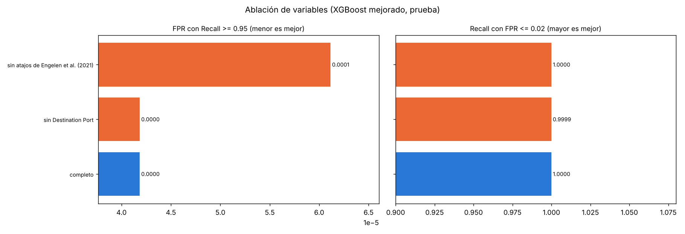

# Experimentos formales: CICIDS2017

Generado por `python -m src.experiments_report`. Todas las cifras son del conjunto de prueba salvo que se indique otra cosa.

## 2. Pruebas pareadas entre modelos

Bootstrap pareado sobre las mismas filas de prueba (semilla 42), cada modelo con su propio umbral elegido en validación. Diferencia = A menos B, con IC 95 % y p bilateral. Mide solo el ruido de muestreo de la prueba. A diferencia de comparar intervalos separados (que pueden solaparse aunque haya diferencia), la prueba pareada aprovecha que ambos modelos ven los mismos flujos.

| Comparación | Punto de operación | Diferencia de Recall [IC 95 %] (p) | Diferencia de FPR [IC 95 %] (p) |
|---|---|---|---|
| RF mejorado frente a RF base | umbral 0.5 | -0.0086 [-0.0094, -0.0078] (p=0.000) | -0.0002 [-0.0003, -0.0001] (p=0.000) |
| RF mejorado frente a RF base | Recall >= 0.95 | -0.0188 [-0.0204, -0.0174] (p=0.000) | +0.0000 [+0.0000, +0.0000] (p=0.002) |
| RF mejorado frente a RF base | FPR <= 0.02 | -0.0002 [-0.0003, -0.0001] (p=0.001) | +0.0065 [+0.0059, +0.0070] (p=0.000) |
| XGBoost mejorado frente a XGBoost base | umbral 0.5 | +0.0002 [+0.0001, +0.0003] (p=0.003) | +0.0000 [-0.0000, +0.0000] (p=0.772) |
| XGBoost mejorado frente a XGBoost base | Recall >= 0.95 | -0.0011 [-0.0021, -0.0002] (p=0.016) | +0.0000 [-0.0000, +0.0000] (p=0.796) |
| XGBoost mejorado frente a XGBoost base | FPR <= 0.02 | +0.0000 [+0.0000, +0.0000] (p=0.766) | -0.0001 [-0.0003, +0.0000] (p=0.086) |
| Mix mejorado frente a Mix base | umbral 0.5 | -0.0013 [-0.0016, -0.0010] (p=0.000) | -0.0001 [-0.0002, -0.0001] (p=0.000) |
| Mix mejorado frente a Mix base | Recall >= 0.95 | +0.0009 [-0.0008, +0.0029] (p=0.303) | +0.0001 [+0.0001, +0.0001] (p=0.000) |
| Mix mejorado frente a Mix base | FPR <= 0.02 | +0.0000 [-0.0000, +0.0000] (p=1.000) | +0.0012 [+0.0009, +0.0015] (p=0.000) |
| XGBoost mejorado frente a RF mejorado | umbral 0.5 | +0.0101 [+0.0093, +0.0109] (p=0.000) | +0.0001 [+0.0001, +0.0002] (p=0.000) |
| XGBoost mejorado frente a RF mejorado | Recall >= 0.95 | -0.0026 [-0.0047, -0.0005] (p=0.015) | -0.0001 [-0.0002, -0.0001] (p=0.000) |
| XGBoost mejorado frente a RF mejorado | FPR <= 0.02 | +0.0002 [+0.0001, +0.0003] (p=0.000) | -0.0166 [-0.0171, -0.0161] (p=0.000) |
| XGBoost base frente a RF base | umbral 0.5 | +0.0013 [+0.0010, +0.0018] (p=0.000) | -0.0001 [-0.0001, -0.0000] (p=0.004) |
| XGBoost base frente a RF base | Recall >= 0.95 | -0.0203 [-0.0219, -0.0187] (p=0.000) | -0.0001 [-0.0001, -0.0001] (p=0.000) |
| XGBoost base frente a RF base | FPR <= 0.02 | +0.0000 [-0.0000, +0.0001] (p=0.837) | -0.0100 [-0.0104, -0.0096] (p=0.000) |
| Mix mejorado frente a XGBoost mejorado | umbral 0.5 | -0.0014 [-0.0017, -0.0011] (p=0.000) | -0.0001 [-0.0001, -0.0001] (p=0.000) |
| Mix mejorado frente a XGBoost mejorado | Recall >= 0.95 | +0.0014 [-0.0005, +0.0033] (p=0.147) | +0.0001 [+0.0001, +0.0001] (p=0.000) |
| Mix mejorado frente a XGBoost mejorado | FPR <= 0.02 | +0.0000 [+0.0000, +0.0000] (p=1.000) | +0.0038 [+0.0035, +0.0041] (p=0.000) |
| Mix base frente a XGBoost base | umbral 0.5 | +0.0001 [-0.0001, +0.0003] (p=0.215) | +0.0000 [-0.0000, +0.0001] (p=0.581) |
| Mix base frente a XGBoost base | Recall >= 0.95 | -0.0006 [-0.0016, +0.0004] (p=0.222) | +0.0000 [-0.0000, +0.0000] (p=1.000) |
| Mix base frente a XGBoost base | FPR <= 0.02 | +0.0000 [-0.0000, +0.0001] (p=0.756) | +0.0025 [+0.0022, +0.0027] (p=0.000) |

## 4. Ablación de variables (CICIDS2017)

XGBoost con los hiperparámetros de la versión mejorada, reentrenado sin cada grupo de variables sospechosas de actuar como atajo. Los umbrales se vuelven a elegir en validación. Que el rendimiento no baje al quitar un grupo no prueba que el modelo no use atajos, porque otras variables correlacionadas pueden tomar su lugar; sí muestra que el rendimiento no depende de ese grupo.

| Grupo quitado | Variables | Recall (umbral 0.5) | FPR (umbral 0.5) | FPR con Recall >= 0.95 | Recall con FPR <= 0.02 | ROC-AUC |
|---|---|---|---|---|---|---|
| completo | ninguna | 0.9985 | 0.0003 | 0.0000 | 1.0000 | 1.0000 |
| sin Destination Port | Destination Port | 0.9979 | 0.0005 | 0.0000 | 0.9999 | 1.0000 |
| sin atajos de Engelen et al. (2021) | Fwd Header Length; Total Fwd Packets; min_seg_size_forward; Init_Win_bytes_forward; SYN Flag Count; Bwd Packet Length Mean | 0.9955 | 0.0007 | 0.0001 | 1.0000 | 1.0000 |

