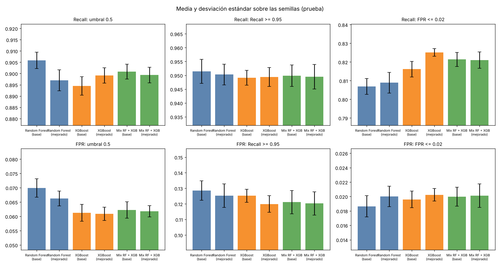
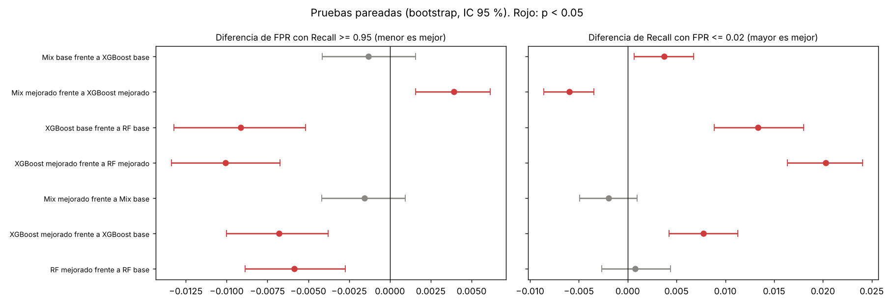
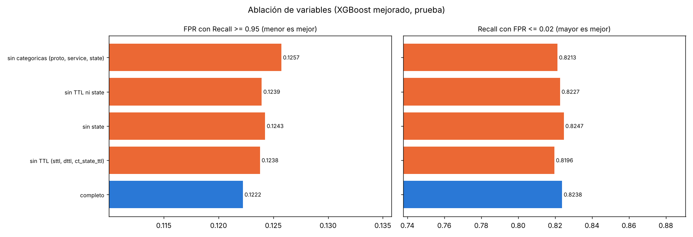

# Experimentos formales: UNSW-NB15

Generado por `python -m src.experiments_report`. Todas las cifras son del conjunto de prueba salvo que se indique otra cosa.

## 1. Repetición con varias semillas

Se repitió la partición 70/15/15 y el ajuste de los seis modelos con las semillas [42, 1, 2, 3, 4]. Cada celda es media ± desviación estándar muestral sobre las semillas, en el conjunto de prueba. Los hiperparámetros de las versiones mejoradas son los de la búsqueda con la semilla 42 y no se volvieron a buscar; además, esos datos de ajuste se solapan con las pruebas de las otras semillas. Por eso la desviación subestima la variación real de repetir también la búsqueda.

### Umbral 0.5

| Modelo | Recall | FPR | Precisión | Accuracy | ROC-AUC |
|---|---|---|---|---|---|
| Random Forest (base) | 0.9059 ± 0.0037 | 0.06990 ± 0.00323 | 0.9117 ± 0.0040 | 0.9194 ± 0.0032 | 0.9809 ± 0.0006 |
| Random Forest (mejorado) | 0.8970 ± 0.0047 | 0.06624 ± 0.00259 | 0.9152 ± 0.0032 | 0.9175 ± 0.0028 | 0.9808 ± 0.0007 |
| XGBoost (base) | 0.8945 ± 0.0041 | 0.06125 ± 0.00296 | 0.9209 ± 0.0034 | 0.9191 ± 0.0021 | 0.9812 ± 0.0006 |
| XGBoost (mejorado) | 0.8991 ± 0.0034 | 0.06091 ± 0.00232 | 0.9216 ± 0.0026 | 0.9214 ± 0.0014 | 0.9823 ± 0.0005 |
| Mix RF + XGB (base) | 0.9009 ± 0.0033 | 0.06224 ± 0.00287 | 0.9202 ± 0.0034 | 0.9214 ± 0.0021 | 0.9822 ± 0.0006 |
| Mix RF + XGB (mejorado) | 0.8993 ± 0.0035 | 0.06182 ± 0.00197 | 0.9206 ± 0.0023 | 0.9210 ± 0.0018 | 0.9821 ± 0.0006 |

### Mínimo fpr con recall >= 0.95

| Modelo | Recall | FPR | Precisión | Accuracy | ROC-AUC |
|---|---|---|---|---|---|
| Random Forest (base) | 0.9514 ± 0.0043 | 0.12857 ± 0.00624 | 0.8550 ± 0.0056 | 0.9069 ± 0.0024 | 0.9809 ± 0.0006 |
| Random Forest (mejorado) | 0.9503 ± 0.0037 | 0.12532 ± 0.00756 | 0.8580 ± 0.0071 | 0.9082 ± 0.0032 | 0.9808 ± 0.0007 |
| XGBoost (base) | 0.9492 ± 0.0027 | 0.12520 ± 0.00422 | 0.8580 ± 0.0040 | 0.9078 ± 0.0020 | 0.9812 ± 0.0006 |
| XGBoost (mejorado) | 0.9494 ± 0.0034 | 0.11990 ± 0.00530 | 0.8632 ± 0.0049 | 0.9108 ± 0.0020 | 0.9823 ± 0.0005 |
| Mix RF + XGB (base) | 0.9499 ± 0.0039 | 0.12113 ± 0.00745 | 0.8621 ± 0.0070 | 0.9103 ± 0.0029 | 0.9822 ± 0.0006 |
| Mix RF + XGB (mejorado) | 0.9495 ± 0.0044 | 0.12033 ± 0.00748 | 0.8628 ± 0.0070 | 0.9106 ± 0.0026 | 0.9821 ± 0.0006 |

### Máximo recall con fpr <= 0.02

| Modelo | Recall | FPR | Precisión | Accuracy | ROC-AUC |
|---|---|---|---|---|---|
| Random Forest (base) | 0.8069 ± 0.0043 | 0.01863 ± 0.00147 | 0.9718 ± 0.0021 | 0.9040 ± 0.0015 | 0.9809 ± 0.0006 |
| Random Forest (mejorado) | 0.8089 ± 0.0055 | 0.02001 ± 0.00141 | 0.9699 ± 0.0020 | 0.9041 ± 0.0022 | 0.9808 ± 0.0007 |
| XGBoost (base) | 0.8162 ± 0.0042 | 0.01960 ± 0.00116 | 0.9707 ± 0.0016 | 0.9076 ± 0.0016 | 0.9812 ± 0.0006 |
| XGBoost (mejorado) | 0.8251 ± 0.0021 | 0.02024 ± 0.00086 | 0.9701 ± 0.0013 | 0.9112 ± 0.0013 | 0.9823 ± 0.0005 |
| Mix RF + XGB (base) | 0.8214 ± 0.0038 | 0.01996 ± 0.00131 | 0.9704 ± 0.0018 | 0.9097 ± 0.0014 | 0.9822 ± 0.0006 |
| Mix RF + XGB (mejorado) | 0.8210 ± 0.0044 | 0.02012 ± 0.00164 | 0.9702 ± 0.0023 | 0.9094 ± 0.0019 | 0.9821 ± 0.0006 |

### Qué modelo gana en cada semilla

| Semilla | Regla de AGENT.md (mínimo FPR con Recall >= 0.95) | Presupuesto (máximo Recall con FPR <= 0.02) |
|---|---|---|
| 1 | Mix RF + XGB (base) | Mix RF + XGB (base) |
| 2 | Mix RF + XGB (base) | XGBoost (mejorado) |
| 3 | XGBoost (mejorado) | XGBoost (mejorado) |
| 4 | XGBoost (mejorado) | XGBoost (mejorado) |
| 42 | XGBoost (mejorado) | XGBoost (mejorado) |

Victorias con la regla de AGENT.md: XGBoost (mejorado) 3, Mix RF + XGB (base) 2. Victorias con el presupuesto de FPR: XGBoost (mejorado) 4, Mix RF + XGB (base) 1.

Reproducibilidad: al reentrenar la semilla 42 se obtienen las mismas métricas guardadas (diferencia absoluta máxima 1.11e-16).

### Versión mejorada menos versión base, semilla por semilla

Diferencia media ± desviación estándar de las diferencias emparejadas por semilla. La última columna cuenta las semillas en que la mejorada gana en la métrica que define el punto (menor FPR con Recall >= 0.95, mayor Recall con FPR <= 0.02, y ambas a la vez con umbral 0.5).

| Algoritmo | Punto de operación | Diferencia de Recall | Diferencia de FPR | Semillas en que gana |
|---|---|---|---|---|
| Random Forest | umbral 0.5 | -0.0089 ± 0.0019 | -0.00366 ± 0.00153 | 0 de 5 |
| Random Forest | Recall >= 0.95 | -0.0011 ± 0.0037 | -0.00325 ± 0.00426 | 3 de 5 |
| Random Forest | FPR <= 0.02 | +0.0020 ± 0.0044 | +0.00138 ± 0.00115 | 4 de 5 |
| XGBoost | umbral 0.5 | +0.0047 ± 0.0012 | -0.00034 ± 0.00182 | 3 de 5 |
| XGBoost | Recall >= 0.95 | +0.0003 ± 0.0019 | -0.00530 ± 0.00187 | 5 de 5 |
| XGBoost | FPR <= 0.02 | +0.0089 ± 0.0024 | +0.00064 ± 0.00185 | 5 de 5 |
| Mix RF + XGB | umbral 0.5 | -0.0015 ± 0.0019 | -0.00042 ± 0.00116 | 1 de 5 |
| Mix RF + XGB | Recall >= 0.95 | -0.0004 ± 0.0021 | -0.00080 ± 0.00322 | 3 de 5 |
| Mix RF + XGB | FPR <= 0.02 | -0.0004 ± 0.0024 | +0.00016 ± 0.00131 | 2 de 5 |

## 2. Pruebas pareadas entre modelos

Bootstrap pareado sobre las mismas filas de prueba (semilla 42), cada modelo con su propio umbral elegido en validación. Diferencia = A menos B, con IC 95 % y p bilateral. Mide solo el ruido de muestreo de la prueba. A diferencia de comparar intervalos separados (que pueden solaparse aunque haya diferencia), la prueba pareada aprovecha que ambos modelos ven los mismos flujos.

| Comparación | Punto de operación | Diferencia de Recall [IC 95 %] (p) | Diferencia de FPR [IC 95 %] (p) |
|---|---|---|---|
| RF mejorado frente a RF base | umbral 0.5 | -0.0078 [-0.0111, -0.0047] (p=0.000) | -0.00242 [-0.00509, +0.00040] (p=0.099) |
| RF mejorado frente a RF base | Recall >= 0.95 | -0.0047 [-0.0076, -0.0020] (p=0.000) | -0.00586 [-0.00887, -0.00274] (p=0.000) |
| RF mejorado frente a RF base | FPR <= 0.02 | +0.0008 [-0.0027, +0.0044] (p=0.682) | -0.00031 [-0.00196, +0.00125] (p=0.745) |
| XGBoost mejorado frente a XGBoost base | umbral 0.5 | +0.0062 [+0.0030, +0.0095] (p=0.000) | +0.00047 [-0.00227, +0.00314] (p=0.718) |
| XGBoost mejorado frente a XGBoost base | Recall >= 0.95 | +0.0009 [-0.0020, +0.0036] (p=0.565) | -0.00680 [-0.01002, -0.00377] (p=0.001) |
| XGBoost mejorado frente a XGBoost base | FPR <= 0.02 | +0.0077 [+0.0042, +0.0113] (p=0.000) | +0.00250 [+0.00078, +0.00426] (p=0.006) |
| Mix mejorado frente a Mix base | umbral 0.5 | +0.0016 [-0.0012, +0.0044] (p=0.308) | -0.00117 [-0.00329, +0.00103] (p=0.325) |
| Mix mejorado frente a Mix base | Recall >= 0.95 | -0.0023 [-0.0047, +0.0002] (p=0.081) | -0.00156 [-0.00418, +0.00093] (p=0.244) |
| Mix mejorado frente a Mix base | FPR <= 0.02 | -0.0020 [-0.0049, +0.0010] (p=0.195) | -0.00008 [-0.00141, +0.00125] (p=0.988) |
| XGBoost mejorado frente a RF mejorado | umbral 0.5 | +0.0037 [+0.0002, +0.0072] (p=0.041) | -0.00719 [-0.01001, -0.00432] (p=0.000) |
| XGBoost mejorado frente a RF mejorado | Recall >= 0.95 | -0.0011 [-0.0039, +0.0017] (p=0.460) | -0.01008 [-0.01337, -0.00674] (p=0.000) |
| XGBoost mejorado frente a RF mejorado | FPR <= 0.02 | +0.0203 [+0.0164, +0.0241] (p=0.000) | +0.00250 [+0.00085, +0.00415] (p=0.003) |
| XGBoost base frente a RF base | umbral 0.5 | -0.0103 [-0.0146, -0.0063] (p=0.000) | -0.01008 [-0.01354, -0.00663] (p=0.000) |
| XGBoost base frente a RF base | Recall >= 0.95 | -0.0067 [-0.0102, -0.0033] (p=0.000) | -0.00914 [-0.01322, -0.00516] (p=0.000) |
| XGBoost base frente a RF base | FPR <= 0.02 | +0.0133 [+0.0089, +0.0180] (p=0.000) | -0.00031 [-0.00237, +0.00173] (p=0.791) |
| Mix mejorado frente a XGBoost mejorado | umbral 0.5 | +0.0001 [-0.0023, +0.0023] (p=0.940) | +0.00125 [-0.00071, +0.00321] (p=0.221) |
| Mix mejorado frente a XGBoost mejorado | Recall >= 0.95 | +0.0000 [-0.0018, +0.0018] (p=0.996) | +0.00391 [+0.00158, +0.00614] (p=0.002) |
| Mix mejorado frente a XGBoost mejorado | FPR <= 0.02 | -0.0060 [-0.0086, -0.0035] (p=0.000) | -0.00234 [-0.00346, -0.00125] (p=0.000) |
| Mix base frente a XGBoost base | umbral 0.5 | +0.0047 [+0.0018, +0.0077] (p=0.001) | +0.00289 [+0.00054, +0.00516] (p=0.017) |
| Mix base frente a XGBoost base | Recall >= 0.95 | +0.0031 [+0.0007, +0.0057] (p=0.012) | -0.00133 [-0.00413, +0.00157] (p=0.385) |
| Mix base frente a XGBoost base | FPR <= 0.02 | +0.0037 [+0.0007, +0.0068] (p=0.015) | +0.00023 [-0.00126, +0.00173] (p=0.799) |

## 3. Particiones oficiales de UNSW-NB15

Modelos base (RF y XGBoost del Entregable 1) con umbral 0.5. La partición oficial de entrenamiento tiene 175.341 flujos y la de prueba 82.332. 'Prueba repetida' es la fracción de filas de prueba cuyo vector exacto aparece en el entrenamiento.

| Protocolo | Modelo | Entrenamiento | Prueba | Prueba repetida | Accuracy | Recall | FPR | ROC-AUC |
|---|---|---|---|---|---|---|---|---|
| A. Particiones oficiales, sin depurar (uso directo de los archivos) | Random Forest (base) | 175 341 | 82 332 | 10.4 % | 0.8700 | 0.9861 | 0.2724 | 0.9784 |
| A. Particiones oficiales, sin depurar (uso directo de los archivos) | XGBoost (base) | 175 341 | 82 332 | 10.4 % | 0.8762 | 0.9814 | 0.2527 | 0.9833 |
| B. Particiones oficiales, depuradas y sin vectores repetidos entre ellas | Random Forest (base) | 100 811 | 52 738 | 0.0 % | 0.8215 | 0.9737 | 0.2641 | 0.9609 |
| B. Particiones oficiales, depuradas y sin vectores repetidos entre ellas | XGBoost (base) | 100 811 | 52 738 | 0.0 % | 0.8294 | 0.9663 | 0.2476 | 0.9668 |
| C1. Validación cruzada de 5 folds sobre el entrenamiento oficial, sin depurar | Random Forest (base) | 140 272 | 35 068 | 46.8 % | 0.9596 ± 0.0009 | 0.9793 ± 0.0004 | 0.0824 ± 0.0025 | 0.9937 ± 0.0003 |
| C1. Validación cruzada de 5 folds sobre el entrenamiento oficial, sin depurar | XGBoost (base) | 140 272 | 35 068 | 46.8 % | 0.9568 ± 0.0012 | 0.9762 ± 0.0009 | 0.0845 ± 0.0030 | 0.9933 ± 0.0003 |
| C2. Validación cruzada de 5 folds sobre el entrenamiento oficial, depurado | Random Forest (base) | 80 648 | 20 162 | 0.0 % | 0.9325 ± 0.0010 | 0.9509 ± 0.0030 | 0.0849 ± 0.0032 | 0.9858 ± 0.0006 |
| C2. Validación cruzada de 5 folds sobre el entrenamiento oficial, depurado | XGBoost (base) | 80 648 | 20 162 | 0.0 % | 0.9326 ± 0.0019 | 0.9457 ± 0.0033 | 0.0798 ± 0.0025 | 0.9859 ± 0.0006 |

En las filas C se promedian los 5 folds (media ± desviación estándar).

## 4. Ablación de variables (UNSW-NB15)

XGBoost con los hiperparámetros de la versión mejorada, reentrenado sin cada grupo de variables sospechosas de actuar como atajo. Los umbrales se vuelven a elegir en validación. Que el rendimiento no baje al quitar un grupo no prueba que el modelo no use atajos, porque otras variables correlacionadas pueden tomar su lugar; sí muestra que el rendimiento no depende de ese grupo.

| Grupo quitado | Variables | Recall (umbral 0.5) | FPR (umbral 0.5) | FPR con Recall >= 0.95 | Recall con FPR <= 0.02 | ROC-AUC |
|---|---|---|---|---|---|---|
| completo | ninguna | 0.8998 | 0.0612 | 0.1222 | 0.8238 | 0.9823 |
| sin TTL (sttl, dttl, ct_state_ttl) | sttl; dttl; ct_state_ttl | 0.8992 | 0.0629 | 0.1238 | 0.8196 | 0.9818 |
| sin state | state | 0.8990 | 0.0617 | 0.1243 | 0.8247 | 0.9823 |
| sin TTL ni state | sttl; dttl; ct_state_ttl; state | 0.8981 | 0.0631 | 0.1239 | 0.8227 | 0.9816 |
| sin categoricas (proto, service, state) | proto; service; state | 0.8987 | 0.0625 | 0.1257 | 0.8213 | 0.9818 |

